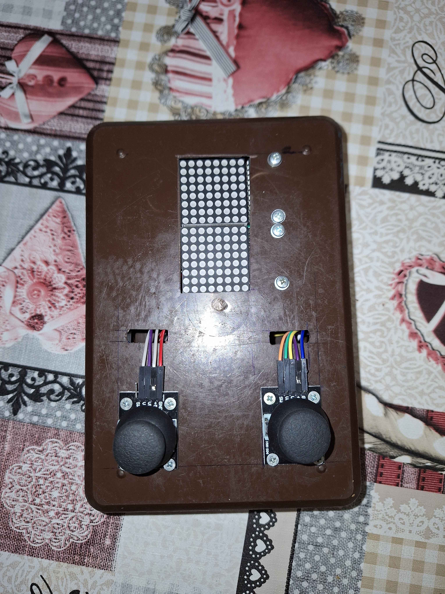
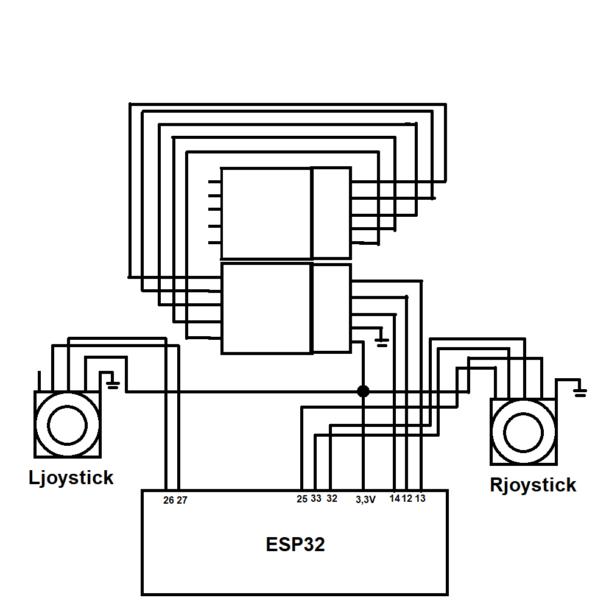

# Tbox
## A Game Console made with C++ in VSCode + **PlatformIO** Extension for an ESP32

# Included games: Snake, Tetris
# Snake Controls:
- Left Joystick
# Tetris Controls: 
- Left Joystick: move tetromino
- Right Joystick (holding downwards): drop tetromino faster
- Right Joystick (joystick button): drops tetromino instantly
- Right Joystick (left or right): rotate tetromino

## **Hardware Required:** 
2 8x8 LED matrices, 2 joysticks, ESP32

## Schematic:

